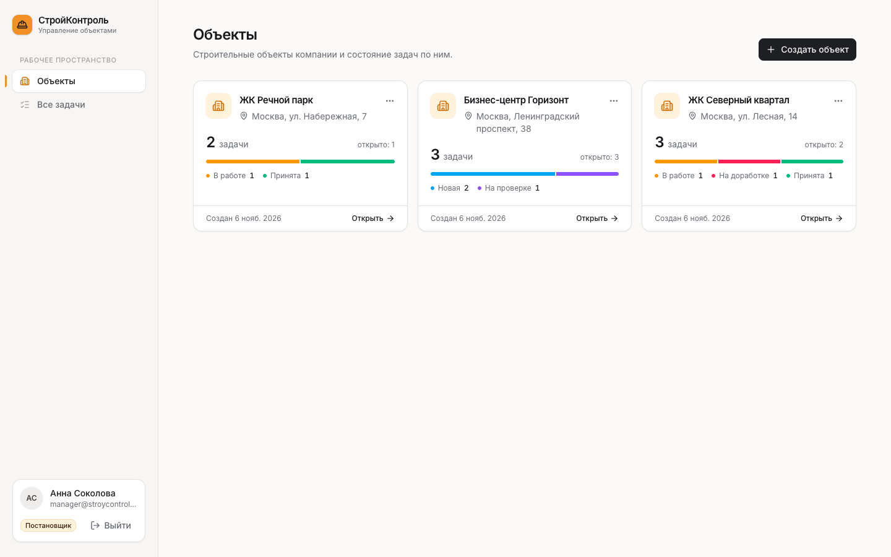
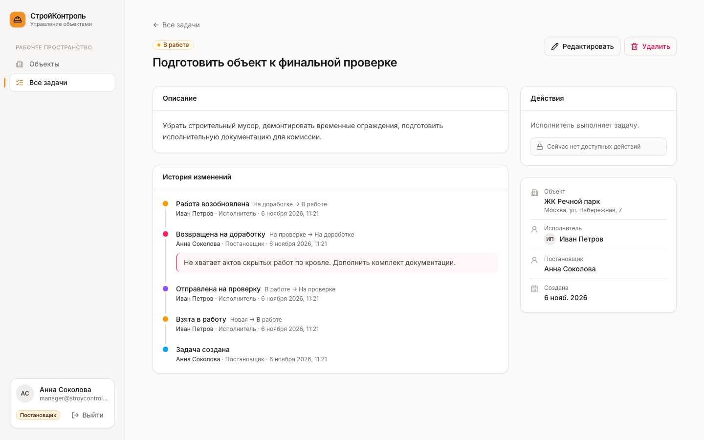
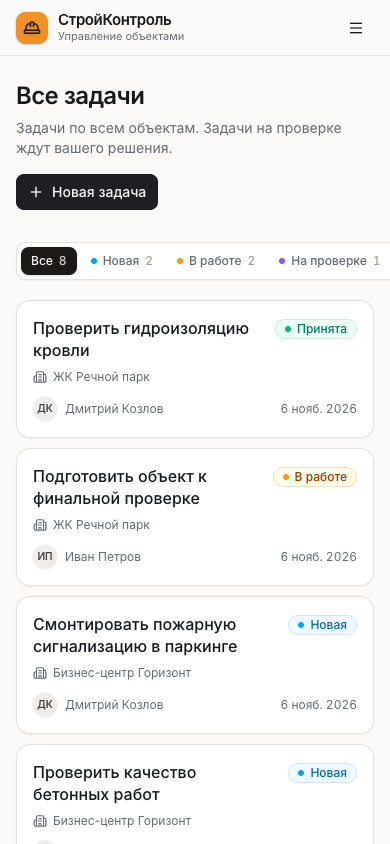

# СтройКонтроль (StroyControl)

A Russian-language mini CRM for a construction company. Managers (**Постановщик**) create construction sites (**Объекты**), assign tasks to executors (**Исполнитель**) and review the results. Executors see only their own tasks, do the work and submit it for review.

**The database is the security boundary.** Every rule (who can see what, who can change what, which status transitions are legal) is enforced in PostgreSQL through RLS, column privileges, triggers and one narrow workflow RPC. The React app is only a client: someone calling the Supabase API directly with a valid token gets exactly the same answers.

| Manager — sites | Task — history timeline | Mobile |
|---|---|---|
|  |  |  |

---

## Contents

1. [Tech stack](#tech-stack)
2. [Quick start (local)](#quick-start-local)
3. [Deploying to a cloud Supabase project](#deploying-to-a-cloud-supabase-project)
4. [Demo data and passwords](#demo-data-and-passwords)
5. [Project structure](#project-structure)
6. [Security model](#security-model)
7. [Task workflow](#task-workflow)
8. [Design decisions](#design-decisions)
9. [Testing](#testing)
10. [Limitations and possible next steps](#limitations-and-possible-next-steps)

---

## Tech stack

| Area | Choice |
|---|---|
| UI | React 19, TypeScript (strict, no `any`), Vite 8 |
| Styling | Tailwind CSS 4, shadcn/ui (Radix), Lucide icons, Inter (bundled locally, Cyrillic) |
| Data | Supabase JS v2, TanStack Query 5 |
| Routing | React Router 7 (data router, lazy-loaded screens) |
| Forms | React Hook Form + Zod 4 |
| Dates | date-fns (`ru` locale) |
| Backend | Supabase Postgres 15 + Auth. **No custom server.** |
| DB tests | pgTAP (`supabase test db`) |

---

## Quick start (local)

**Prerequisites:** Node.js **22.12+** (`.nvmrc` is included; Vite 8 does not run on Node 20), Docker, and the [Supabase CLI](https://supabase.com/docs/guides/cli).

```bash
npm install

# 1. Start local Supabase and apply all migrations
supabase start
supabase db reset           # applies supabase/migrations/* in order

# 2. Frontend env: public values only
cp .env.example .env.local
#   put the "API URL" and "anon key" printed by `supabase status` into .env.local

# 3. Demo users and data. Pick any password: 8+ characters, letters and digits.
DEMO_PASSWORD='ChooseYourOwn123' npm run seed:local

# 4. Run
npm run dev                 # http://localhost:5173
```

Sign in as `manager@stroycontrol.test`, `petrov@stroycontrol.test` or `kozlov@stroycontrol.test` with the password you chose.

In the local stack, open signup is already disabled in `supabase/config.toml` (`[auth] enable_signup = false`).

### Useful scripts

| Script | What it does |
|---|---|
| `npm run dev` / `build` / `preview` | Vite dev server / type-check + production build / serve `dist` |
| `npm run typecheck`, `npm run lint` | `tsc -b`, oxlint |
| `npm run db:reset` | Recreate the local DB from migrations |
| `npm run db:test` | Run the pgTAP security and workflow suite (70 tests) |
| `npm run db:types` | Regenerate `src/lib/database.types.ts` from the live schema |
| `npm run seed:local` | Idempotent demo provisioning against the local stack |
| `npm run verify:local` | API-level attack test using only the public key (needs seeded data) |

---

## Deploying to a cloud Supabase project

1. **Create a project** at supabase.com.
2. **Apply migrations**
   ```bash
   supabase login
   supabase link --project-ref <your-project-ref>
   supabase db push
   ```
3. **Disable open signup. This is required and must be done by hand.**
   `config.toml` only affects the local stack. In the dashboard, open
   **Authentication → Sign In / Providers → User Signups** and turn **"Allow new users to sign up" OFF**.
   Keep the **Email** provider enabled so password login keeps working.
   Leave anonymous sign-ins disabled (the default).
   With signup off, `POST /auth/v1/signup` returns `422 signup_disabled`. Accounts are created only by an administrator.
4. **Provision users** (pick one):
   * Demo data: `cp .env.seed.example .env.seed.local`, fill in the values, run `npm run seed`, then **delete `.env.seed.local`**.
   * Real users: create the user in **Authentication → Users → Add user**, then insert the profile in the SQL editor:
     ```sql
     insert into public.profiles (id, full_name, role)
     values ('<auth user id>', 'Фамилия Имя', 'executor');  -- or 'manager'
     ```
5. **Build the frontend** with `VITE_SUPABASE_URL` and `VITE_SUPABASE_PUBLISHABLE_KEY` (Project Settings → API) and host `dist/` on any static host. Configure an SPA fallback so every path serves `index.html`.
6. Under **Authentication → URL Configuration**, set **Site URL** to the deployed origin.

### Secrets

| Value | Where it may live |
|---|---|
| Project URL, publishable/anon key | Frontend (`VITE_*`). Public by design: they grant nothing beyond what RLS allows. |
| `service_role` / secret key, DB password, demo passwords | Only on an admin machine, in `.env.seed.local` or the shell. Never `VITE_`-prefixed, never committed, never packaged. |

`.gitignore` excludes every `.env*` file except the two `*.example` templates. The local seed wrapper reads keys from `supabase status` at runtime and never writes them to disk.

---

## Demo data and passwords

`scripts/seed-demo.ts` is **idempotent**:

1. It creates or updates three accounts with the service key (email confirmed, password set from `DEMO_PASSWORD`) and upserts their profiles. Assigning a role is an admin action.
2. If none of the demo sites exist yet, it **signs in as each demo user with the public key** and drives the real workflow: inserts plus `transition_task_status` calls. Every history row is therefore written by the same trusted database code the app uses. Nothing is forged, which also means all demo timestamps are "now".

| Account | Name | Role |
|---|---|---|
| `manager@stroycontrol.test` | Анна Соколова | Постановщик |
| `petrov@stroycontrol.test` | Иван Петров | Исполнитель |
| `kozlov@stroycontrol.test` | Дмитрий Козлов | Исполнитель |

The script creates 3 sites and 8 tasks covering all five statuses. Both executors have tasks in several statuses, and two tasks went through a rework cycle with a comment. The sites ЖК Северный квартал and Бизнес-центр Горизонт each contain tasks for **both** executors, so the per-executor isolation inside a shared site can be shown.

**Setting passwords safely:** pass `DEMO_PASSWORD` through the environment for that single command (as shown above) or a git-ignored `.env.seed.local`. No password is stored in the repository. Re-running the script rotates the password. To change one password, use Dashboard → Authentication → Users → *Reset password* or `auth.admin.updateUserById`.

---

## Project structure

```
supabase/
  config.toml                      local stack config (signup disabled)
  migrations/
    …0100_schema.sql               enums, tables, constraints, indexes
    …0200_private_helpers_and_triggers.sql
                                   private schema, RLS helpers, integrity triggers
    …0300_workflow_functions.sql   transition_task_status, archive_task, archive_site
    …0400_rls_policies.sql         RLS policies
    …0500_privileges.sql           REVOKE/GRANT (column-level)
  tests/database/security.test.sql pgTAP suite
scripts/
  seed-demo.ts, seed-local.sh      demo provisioning (admin side only)
  verify-api.ts, verify-local.sh   API-level attack test
src/
  api/          TanStack Query hooks (sites, tasks, history, executors)
  auth/         AuthProvider (session restore, profile, expiry), RequireAuth gate
  components/   layout (sidebar / mobile sheet), StatusBadge, EmptyState, ConfirmDialog, ui/ (shadcn)
  features/
    sites/      SitesPage, SiteDetailsPage, SiteFormDialog, ArchiveSiteDialog, StatusBreakdown
    tasks/      TasksPage, TaskDetailsPage, TaskList, StatusFilter, TaskFormDialog, ReworkDialog, TaskTimeline
  lib/          supabase client, generated DB types, status metadata, error mapping, formatting
  pages/        LoginPage, NotFound, ConfigMissing
```

---

## Security model

The defences are layered, and each layer would block the attack on its own:

| Layer | What it does |
|---|---|
| **Privileges** (`…0500`) | Everything is revoked from `anon`/`authenticated`, then the minimum is granted back. API users get `SELECT` on the four tables. `INSERT`/`UPDATE` is granted **only on specific columns**: `sites(name, address)` and `tasks(title, description, site_id, assignee_id)`. There is no `DELETE` anywhere and no write access to `profiles` or `task_status_history`. `anon` has nothing. |
| **RLS** (`…0400`) | Enabled and forced on all four tables. Policies apply to `authenticated` only and decide **which rows** a user can touch. |
| **Triggers** (`…0200`) | Server-controlled values (`status = 'new'`, `created_by = auth.uid()`, timestamps) and invariants: the assignee must have the `executor` role, the site must be active, immutable columns stay immutable, accepted tasks are frozen, history is append-only. |
| **Workflow RPC** (`…0300`) | The *only* code that can change `status` or `archived_*`. |
| **CHECK constraints** | `task_status_history` itself rejects any illegal `(from, to)` pair and any rework entry without a comment, as a last line of defence against bugs in trusted code. |

### Identity and roles

* Identity is always `auth.uid()`, taken from the verified JWT. No function accepts a user id or a role as input.
* The role lives in `profiles.role`. Profiles are created only by an admin (service role or SQL); nothing reads signup metadata. API users cannot write `profiles` at all, so an executor cannot promote themselves.
* A user with a valid login but **no profile** gets `null` from `private.current_user_role()`. Every policy fails, every RPC raises, and the UI shows «Доступ не предоставлен».
* The React app reads the role only to decide which buttons to show.

### RLS rules

| Table | Manager | Executor |
|---|---|---|
| `profiles` | read all | read self, plus the authors of and history actors on their current tasks (needed to show names in the timeline) |
| `sites` | read / insert / update active sites | read only active sites containing ≥1 active task **currently assigned to them** |
| `tasks` | read / insert / update active tasks | read only active tasks where `assignee_id = auth.uid()` |
| `task_status_history` | read history of active tasks | read history of their **currently assigned** active tasks |

* **No recursion.** Role checks call `private.is_manager()` / `private.current_user_role()`, which are `SECURITY DEFINER` functions that read `profiles` without going through its RLS. The only policy-to-policy dependency is `sites → tasks`, and it runs one way.
* **No leaks through joins or counts.** Every table filters itself. When an executor embeds `sites → tasks` (which the site cards do), the embedded tasks are filtered by `tasks`' own policy, so counts and status bars only include their own tasks. This is covered by both test suites.
* `auth.uid()` and the role helpers are wrapped in `(select …)` so Postgres evaluates them once per statement, not once per row.
* The `private` schema is **not exposed** by the Data API. `authenticated` may execute only the three read-only helpers that policies need.

### `transition_task_status(p_task_id, p_to_status, p_comment)`

`SECURITY DEFINER`, `search_path = ''`, every object schema-qualified, `EXECUTE` granted to `authenticated` only. The steps:

1. `auth.uid()` must be set, and the role is loaded from `profiles`.
2. The task row is loaded with **`SELECT … FOR UPDATE`** *before* its status is read. Concurrent transitions, reassignments and archiving are serialised on this lock.
3. A missing, archived or "not yours" task (for executors) all return the same `P0002` error, so ids cannot be probed.
4. The `(from, to)` pair is looked up in the transition table, and the required role is checked: the executor transitions need the **current assignee**, the review transitions need a manager.
5. A rework requires a non-blank comment (≤ 2000 characters).
6. The `UPDATE` runs under a transaction-local flag (`stroycontrol.workflow_write`). The `tasks` trigger rejects any status change without that flag, as defence in depth on top of the missing column privilege.
7. Exactly one history row is inserted with the actor, the from/to statuses, the comment and `now()`.
8. All of this happens in a single transaction: any exception rolls back both the update and the insert.

`archive_task` and `archive_site` follow the same pattern (manager check, row locks, flag).

### Threat → mitigation

| Attack (direct API call) | Result |
|---|---|
| `PATCH /tasks {status:'accepted'}` as executor **or manager** | `403 permission denied for column status` |
| `POST /tasks {status, created_by, created_at}` | `403` (columns not insertable). `created_by` and `status` are also forced by the trigger. |
| Executor `PATCH /tasks {assignee_id}` or `{title}` | 0 rows (RLS: manager-only update) |
| Executor `PATCH /profiles {role:'manager'}` | `403` (no UPDATE privilege) |
| `POST /task_status_history` | `403` (no INSERT privilege); `UPDATE`/`DELETE` are blocked even for the DB owner by a trigger |
| `DELETE /tasks` or `/sites` | `403` (no DELETE privilege) |
| Executor RPC on another executor's task | `P0002` «Задача не найдена или у вас нет к ней доступа» |
| Executor accepts own task / skips a step | `42501` / `22023` |
| Old assignee after reassignment | Loses read access to the task, its history and the site, and cannot transition it, immediately |
| Assign a task to a manager or a user without a profile | `23514` |
| Anonymous key only | `401/403` on every table and RPC |
| `POST /auth/v1/signup` | `422 signup_disabled` |

---

## Task workflow

| From | To | Who | Button | Condition |
|---|---|---|---|---|
| *(creation)* | Новая | Manager | «Новая задача» | automatic; `status`, `created_by`, `created_at` are set by the DB |
| Новая | В работе | **Current** assignee | «Взять в работу» | |
| В работе | На проверке | **Current** assignee | «Отправить на проверку» | |
| На проверке | Принята | Manager | «Принять задачу» (with confirmation) | final status |
| На проверке | На доработке | Manager | «Вернуть на доработку» (dialog) | non-blank comment required |
| На доработке | В работе | **Current** assignee | «Продолжить работу» | |

Every other pair is rejected by the RPC, and also by the `history_valid_transition` CHECK constraint.

The UI never offers a general status selector. It shows only the buttons that are valid for the current role and status (`src/lib/status.ts`). This mirror exists for UX only; the database decides.

---

## Design decisions

**Soft delete.** Sites and tasks are archived (`archived_at`, `archived_by`), never hard-deleted through the API.
* Archived rows are invisible to **all** API users, managers included. Their history stays in the database (FKs are `ON DELETE RESTRICT`) and is available to admins.
* Archived tasks cannot be transitioned or edited.
* **Archiving a site archives all of its active tasks in the same transaction.** The confirmation dialog shows how many tasks will be removed. A task cannot be created on, or moved to, an archived site (`FOR SHARE`/`FOR UPDATE` locking prevents a race).
* Restoring from the archive is out of scope. An admin can restore with SQL.

**Reassignment.**
* Managers can reassign at any non-final status. **The status is never reset or changed.**
* Executor access is defined by `assignee_id = auth.uid()`, so the previous executor loses access to the task, **its history** and (if it was their only task there) the site **immediately**, even through the API.
* **History visibility follows the current assignee:** the new executor sees the full history, including the previous executor's entries and name. This is intentional, so the new executor knows the context and any rework comments.
* *Extra consistency rule:* an **accepted** task cannot be reassigned or moved to another site, because it is a closed record of who did the work and where. Title and description can still be corrected.

**Role changes.** A trigger blocks changing an executor's role while they still have active tasks, which would otherwise leave tasks assigned to a non-executor.

**Creation is a transition.** Task creation writes a `∅ → new` history entry, so the timeline starts with «Задача создана». `from_status` is nullable only for this entry, and a CHECK constraint enforces that.

**Comments.** The RPC accepts an optional comment on any transition; it is mandatory only for `rework`. The UI asks for a comment only when returning a task for rework, as the brief specifies. Executor actions are single clicks.

**Unique site names.** Active sites must have unique names (case- and whitespace-insensitive partial unique index). The form shows the conflict as a field error.

**Errors.** Database functions raise Russian messages with standard SQLSTATE codes (`42501` permission, `P0002` not found, `22023` invalid transition or input, `23514` business rule). The client shows Cyrillic messages as-is and maps generic codes to friendly text (`src/lib/errors.ts`). A missing record and a forbidden record look identical to the user («не найдена или нет доступа») on purpose.

**Sessions.**
* The session is restored on reload, and tokens auto-refresh.
* If a refresh fails, or the API returns an expired-JWT error, the app signs out locally, redirects to `/login` and shows «Сессия истекла». The originally requested URL is restored after the next login.
* Signing in as a different user on the same device clears the query cache.

**Performance.** Partial indexes match the RLS predicates (`assignee_id`, `site_id`, `status` where `archived_at is null`). Screens behind login are lazy-loaded, and vendors are split into cacheable chunks (react, supabase, radix, forms). The login page loads about 260 kB of gzipped JS.

---

## Testing

### 1. Database: pgTAP (`npm run db:test`)

`supabase/tests/database/security.test.sql` has **70 assertions**. It impersonates real API users (`SET ROLE authenticated` plus `request.jwt.claims`) and covers:

* the anonymous user
* manager CRUD and forged columns
* executor visibility: own tasks, own sites, shared-site joins, other executors' history and profiles
* every forbidden write: sites, tasks, status, roles, history, hard delete, archiving
* every allowed and forbidden transition, including terminal `accepted`
* rework comment validation
* exactly one history row per transition
* reassignment (old executor loses everything, new one continues)
* archiving (hidden, frozen, history preserved)
* a user with no profile
* history immutability even for the DB owner

```
./database/security.test.sql .. ok
All tests successful.  Tests=70  Result: PASS
```

### 2. API: attack script (`DEMO_PASSWORD=… npm run verify:local`)

Uses only the public key, as a real client would, against seeded data: 15 checks covering anonymous reads, raw `PATCH status` as an executor and as a manager, role escalation, history forgery, RPC on another executor's task, `sites→tasks` embedding leaks and hard delete. All pass.

### 3. End-to-end (manual, headless Chrome)

These flows were exercised in a real browser during development:

* login validation and wrong password
* redirect when unauthenticated
* session restore on reload
* status filter in the URL
* rework with mandatory-comment validation
* site creation, including the duplicate-name error
* task creation on a site
* reassignment
* task and site archiving
* not-found pages
* logout
* the executor `rework → in_progress → in_review` flow, with no edit controls shown
* the no-profile screen
* expired-session redirect with the notice
* executor isolation inside a shared site
* a 390 px mobile layout with no horizontal overflow

There is no committed browser test runner, to avoid adding heavy dependencies; this is listed below as a next step.

---

## Limitations and possible next steps

* No archive/restore UI, no user-management UI (provisioning is an admin task by design), no file attachments.
* Pagination is not implemented. That is fine at the scale of one company's sites, but would be needed for thousands of tasks.
* Realtime updates are not wired in. Data refreshes on window focus and after every mutation.
* A committed Playwright suite and CI (`db:test` + `verify:local` + `build`) would be the next additions.
